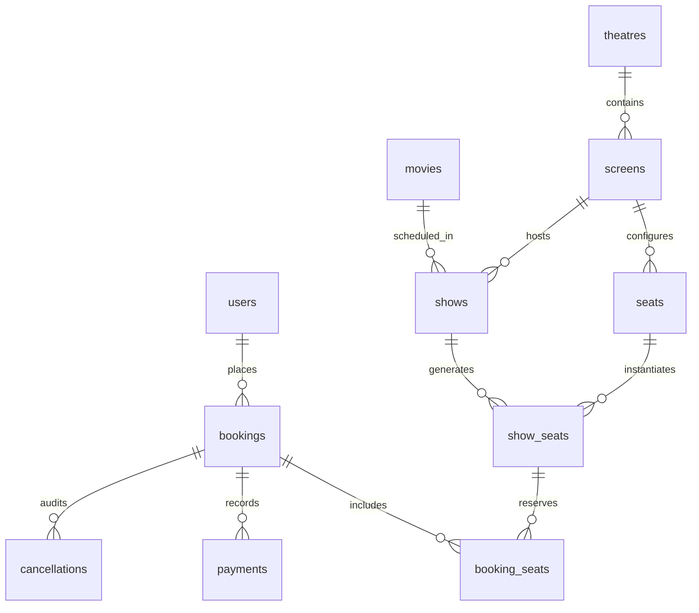

# CineBook – Movie Ticket Booking System
## Comprehensive Multi-Member Project Documentation

[]()
[]()
[]()
[]()

---

## 1. Project Overview

**CineBook** is a 3-member college project developing a high-integrity, terminal-based Movie Ticket Booking System in **Java 17**, **JDBC**, and **MySQL 8**. The application models a complete cinema complex workflow—from customer registration and movie screening management to live seat layout rendering, atomic seat reservations, simulated payment processing, and procedure-driven cancellations with automated 80% refunds.

The architecture emphasizes pure JDBC transactions (no ORM or Spring Boot), robust object-oriented design patterns, strict check constraint enforcement, and advanced MySQL features including database triggers and stored procedures.

---

## 2. Key Features

- **User Authentication & Management (Member 1):**
  - Secure customer registration with email deduplication.
  - SHA-256 password hashing via `PasswordUtil`.
  - Role-based separation (`ADMIN`, `CUSTOMER`, `STAFF`).

- **Movie, Complex & Show Scheduling (Member 1):**
  - Multi-theatre and multi-screen management.
  - Automated physical seat grid generation (5 rows × 8 columns = 40 seats).
  - Independent `show_seats` instance creation per scheduled screening, guaranteeing that booking seats for Show A does not alter Show B.

- **Seat Layout & Atomic Reservations (Member 2):**
  - Formatted 2D console seat maps with tier visualization (`[O]` = Available, `[X]` = Booked).
  - Pricing derived directly from `SeatType` enum:
    - Rows A–B: **Regular** (Rs. 150)
    - Rows C–D: **Premium** (Rs. 250)
    - Row E: **VIP** (Rs. 400)
  - Strict validation rejecting invalid seat codes (e.g., `Z9`) and already-booked seats.
  - All-or-nothing atomic reservations using JDBC transaction management (`setAutoCommit(false)` and `rollback()`).
  - Promotional coupon support (`CINE10` provides a 10% discount).
  - Sequential `BK1001`-style unique booking codes.

- **Simulated Payment Gateway (Member 3):**
  - Simulated payment processing across three methods: **CASH**, **UPI**, and **CARD**.
  - Strict simulation boundaries: No actual card numbers, bank PINs, or live payment gateway APIs are requested or stored.
  - Exact payment transaction status tracking: `SUCCESS`, `REFUNDED`, `FAILED`.
  - Customer payment confirmation dialog and receipt formatting.

- **Procedure-Backed Cancellation & 80% Refund (Member 3):**
  - Stored procedure `sp_cancel_booking` manages end-to-end cancellation logic atomically in MySQL.
  - Calculates 80% refund strictly based on `final_amount` (after coupon deductions), never on gross total.
  - Releases associated show seats back to `AVAILABLE`.
  - Updates booking status to `CANCELLED` and payment status to `REFUNDED`.
  - Inserts audit records into `cancellations` table with status `COMPLETED`.
  - Rejects invalid IDs and duplicate cancellation attempts.

- **Database Synchronization Trigger (Member 3):**
  - MySQL 8 trigger `trg_update_seat_status` automatically transitions `show_seats.status` to `BOOKED` whenever line items are inserted into `booking_seats`.

- **Unified Interactive Terminal UI (Member 3):**
  - Clean 10-option console menu in `Main.java` orchestrating the workflows across all three modules.

---

## 3. Technologies Used

| Technology | Specification / Purpose |
|---|---|
| **Programming Language** | Java 17 (LTS) or higher |
| **Database** | MySQL 8.0+ Community Server (InnoDB Engine) |
| **Database Connectivity** | JDBC (`com.mysql:mysql-connector-j:8.3.0`) |
| **Build & Dependency Tool** | Apache Maven 3.8+ |
| **Testing Framework** | JUnit 5 Jupiter (`5.10.2`) |
| **Version Control** | Git & GitHub |

---

## 4. Package Architecture

The codebase adheres strictly to the unified package structure:

```
com.cinebook
├── Main.java                        # Terminal UI Application Entry Point
├── database
│   └── DBConnection.java            # Centralized JDBC connection factory
├── model
│   ├── Bookable.java                # Interface for bookable show events
│   ├── Booking.java                 # Booking entity with pricing & summary
│   ├── BookingSeat.java             # Line-item seat association model
│   ├── Cancellation.java            # Cancellation & refund audit entity
│   ├── Movie.java                   # Movie catalog entity
│   ├── Payment.java                 # Payment transaction entity
│   ├── Screen.java                  # Screen auditorium model
│   ├── Seat.java                    # Screen physical seat entity
│   ├── SeatType.java                # Seat tier enum (REGULAR, PREMIUM, VIP)
│   ├── Show.java                    # Show screening entity
│   ├── ShowSeat.java                # Independent live show seat model
│   ├── Theatre.java                 # Cinema complex entity
│   └── User.java                    # User model with SHA-256 hashed password
├── dao
│   ├── BookingDAO.java              # Bookings & booking line-items DAO
│   ├── CancellationDAO.java         # Stored procedure & cancellations DAO
│   ├── MovieDAO.java                # Movie CRUD & search queries
│   ├── PaymentDAO.java              # Payment persistence & queries
│   ├── ScreenDAO.java               # Screens & default 5x8 grid provisioning
│   ├── SeatDAO.java                 # Seat lookups & 2D array grid mapping
│   ├── ShowDAO.java                 # Show scheduling & show seat queries
│   ├── TheatreDAO.java              # Cinema theatres DAO
│   └── UserDAO.java                 # User persistence & unique email checks
├── service
│   ├── BookingService.java          # Atomic booking transactions & coupons
│   ├── CancellationService.java     # Cancellation & procedure orchestrator
│   ├── MovieService.java            # Movie & venue management
│   ├── PaymentService.java          # Simulated payment gateway logic
│   ├── SeatService.java             # 2D seat map rendering & validation
│   ├── ShowService.java             # Show schedules & seat map generation
│   └── UserService.java             # Registration & authentication
└── util
    ├── ConfigLoader.java            # Properties loader
    └── PasswordUtil.java            # SHA-256 password hashing & verification
```

---

## 5. Database Schema & Architecture (`cinebook_db`)

The database consists of **11 normalized tables** in MySQL 8:



### Table Manifest

1. `users`: Customer, Admin, and Staff user credentials.
2. `movies`: Film titles, language, genre, duration, and release date.
3. `theatres`: Complex name, city, and street address.
4. `screens`: Auditoriums associated with a theatre.
5. `seats`: Physical screen seat layout (5x8 grid: A1 to E8).
6. `shows`: Screenings mapping movies to screens at specific dates and times.
7. `show_seats`: Independent live seat availability per show (`AVAILABLE`, `BOOKED`, `LOCKED`).
8. `bookings`: Master booking records with total, discount, and final amounts.
9. `booking_seats`: Line-item show seat associations and price per seat.
10. `payments`: Payment records (`SUCCESS`, `REFUNDED`, `FAILED`).
11. `cancellations`: Cancellation audit records with 80% refund and status (`COMPLETED`).

---

## 6. Database Setup Instructions

Ensure MySQL 8 is running locally.

### Step 1: Run SQL Scripts in Order

Execute the database initialization scripts sequentially:

```bash
# 1. Create database and core 11 tables with constraints
mysql -u root -p < database/schema.sql

# 2. Populate initial sample seed data (Movies, Theatres, Shows, Seats)
mysql -u root -p cinebook_db < database/sample_data.sql

# 3. Create database trigger (trg_update_seat_status)
mysql -u root -p cinebook_db < database/trigger.sql

# 4. Create database stored procedure (sp_cancel_booking)
mysql -u root -p cinebook_db < database/procedures.sql
```

### Step 2: Configure Database Credentials

Configure your local database credentials in `src/main/resources/db.properties`:

```properties
db.url=jdbc:mysql://localhost:3306/cinebook_db?useSSL=false&allowPublicKeyRetrieval=true&serverTimezone=UTC
db.user=root
db.password=your_mysql_password
db.driver=com.mysql.cj.jdbc.Driver
```

---

## 7. How to Run the Application & Tests

### Running Automated Test Suite

Run the full integration test suite covering all 3 members:

```bash
mvn clean test
```

### Running the Terminal Application

Launch the interactive console menu:

```bash
mvn compile exec:java
```

Or run via Java CLI directly:

```bash
java -cp "target/classes;target/dependency/*" com.cinebook.Main
```

### Main Console Menu Overview

```text
=================================================================
            CINEBOOK - MOVIE TICKET BOOKING SYSTEM               
             Java 17 | MySQL 8 | JDBC Architecture               
=================================================================

-----------------------------------------------------------------
 Logged in as: Guest (Please Register or Login to Book/Pay)
-----------------------------------------------------------------
 1.  Register
 2.  Login
 3.  View Movies
 4.  View Shows
 5.  View Seat Map
 6.  Book Tickets
 7.  Make Simulated Payment
 8.  View Booking History
 9.  Cancel Booking
 10. Exit
-----------------------------------------------------------------
```

---

## 8. Team Member Responsibilities

| Member | Assigned Git Branch | Core Responsibilities | Deliverables |
|---|---|---|---|
| **Member 1** | `feature/movie-management` | Database architecture, JDBC connection factory, User authentication, Movie catalog, Theatre & Screen management, Show scheduling with independent seat instances. | `schema.sql`, `sample_data.sql`, `DBConnection.java`, `UserDAO`, `MovieDAO`, `TheatreDAO`, `ScreenDAO`, `ShowDAO`, `UserService`, `MovieService`, `ShowService`, `Member1IntegrationTest` |
| **Member 2** | `feature/seat-booking` | Seat management (5x8 grid via 2D array), Seat availability tracking, Atomic booking transactions (`setAutoCommit(false)`), Pricing & coupon calculation (`SeatType`, `CINE10`), Booking summaries. | `SeatDAO`, `BookingDAO`, `SeatType`, `Bookable`, `BookingSeat`, `Booking`, `SeatService`, `BookingService`, `Member2IntegrationTest` |
| **Member 3** | `feature/payment-cancellation` | Simulated payment processing (`CASH`, `UPI`, `CARD`), Payment receipts, MySQL trigger (`trg_update_seat_status`), Stored procedure (`sp_cancel_booking`), 80% refund calculation, Stored procedure invocation, Main console menu (`Main.java`), and Final integration. | `trigger.sql`, `procedures.sql`, `Payment.java`, `Cancellation.java`, `PaymentDAO`, `CancellationDAO`, `PaymentService`, `CancellationService`, `Main.java`, `Member3IntegrationTest`, `README.md` |

---

## 9. GitHub Collaboration Process

The team followed a feature branch workflow:

1. **Member 1** initialized the repository, created the base Maven structure, authored `schema.sql`, and established JDBC connection handling on branch `feature/movie-management`.
2. **Member 2** branched off Member 1's work into `feature/seat-booking`, implementing seat grids, atomic booking transactions, and coupon calculations without breaking existing code.
3. **Member 3** branched from `feature/seat-booking` into `feature/payment-cancellation`, delivering simulated payments, the MySQL trigger, the stored procedure for cancellation/refund, the unified `Main.java` menu, and multi-member integration tests.
4. **Integration Verification:** All 29 integration tests pass with zero errors, confirming seamless inter-module communication across all layers.
